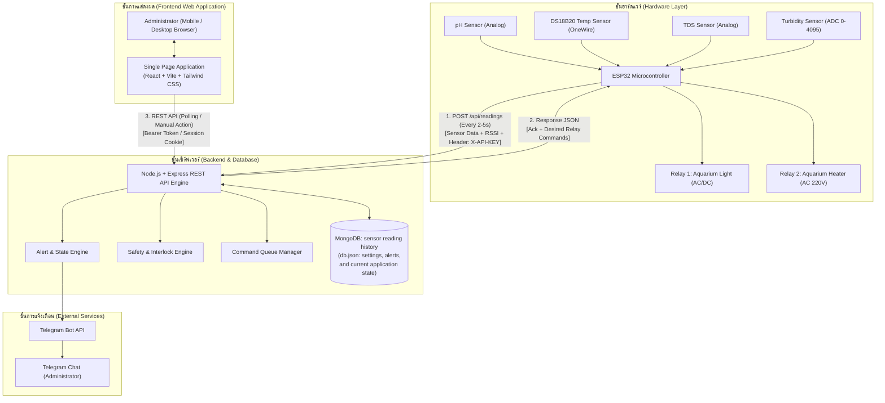
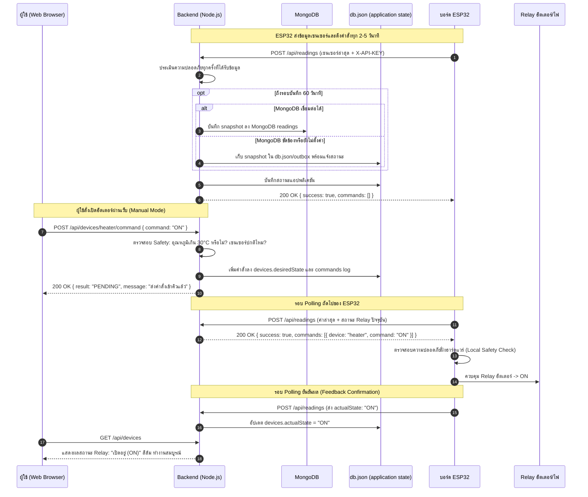
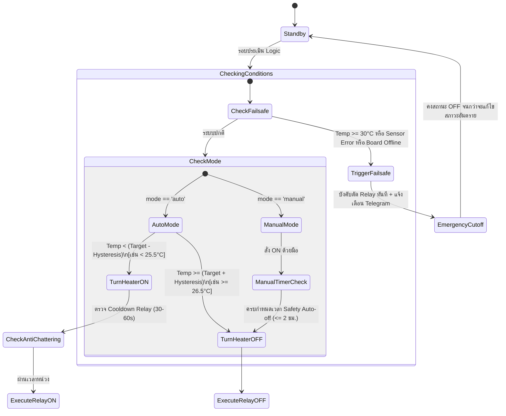
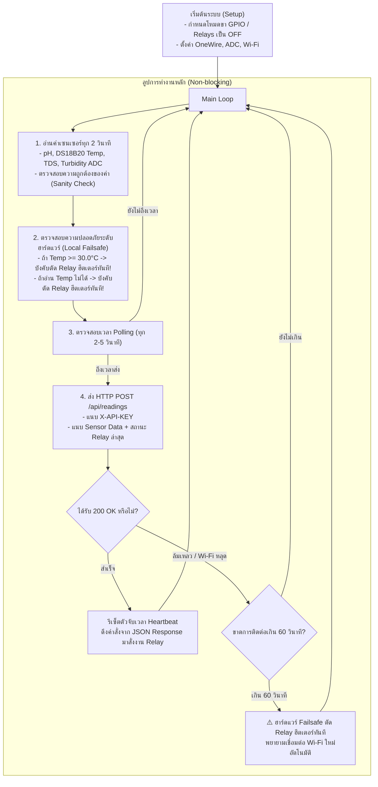
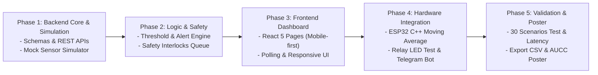

# เอกสารการออกแบบระบบ: Smart Aquarium System Design Document
**โครงการ:** ระบบตรวจวัดและแจ้งเตือนคุณภาพน้ำตู้ปลาอัจฉริยะแบบเรียลไทม์ (Real-Time Water Quality Alert & Control System for Smart Aquarium)  
**เอกสารอ้างอิง:** `smart_aquarium_technical_specification.md` & `สเปกหน้าเว็บ Smart Aquarium Dashboard`  
**สถานะ:** ฉบับสมบูรณ์ (Production & Prototype Blueprint)  
**เป้าหมายการนำไปใช้:** พัฒนาระบบต้นแบบ (Prototype), การทดสอบระบบ 30 Scenarios และการนำเสนอผลงานวิชาการ/โปสเตอร์ (AUCC)

---

## สารบัญ (Table of Contents)
1. [ภาพรวมโครงการและวัตถุประสงค์ (System Overview & Objectives)](#1-ภาพรวมโครงการและวัตถุประสงค์-system-overview--objectives)
2. [สถาปัตยกรรมระบบโดยรวม (System Architecture)](#2-สถาปัตยกรรมระบบโดยรวม-system-architecture)
3. [การออกแบบฮาร์ดแวร์และเซนเซอร์ (Hardware & Sensor Specifications)](#3-การออกแบบฮาร์ดแวร์และเซนเซอร์-hardware--sensor-specifications)
4. [การออกแบบฐานข้อมูล (Database Schema & Data Model)](#4-การออกแบบฐานข้อมูล-database-schema--data-model)
5. [ข้อกำหนด API และการสื่อสาร (REST API & Communication Protocol)](#5-ข้อกำหนด-api-และการสื่อสาร-rest-api--communication-protocol)
6. [ตรรกะการควบคุมและระบบความปลอดภัย (Control Logic & Safety Interlocks)](#6-ตรรกะการควบคุมและระบบความปลอดภัย-control-logic--safety-interlocks)
7. [ระบบเกณฑ์และการแจ้งเตือน (Threshold Engine & Notification System)](#7-ระบบเกณฑ์และการแจ้งเตือน-threshold-engine--notification-system)
8. [การออกแบบเว็บแดชบอร์ดและ UI/UX (Frontend Architecture & UI/UX Design)](#8-การออกแบบเว็บแดชบอร์ดและ-uiux-frontend-architecture--uiux-design)
9. [สถาปัตยกรรมเฟิร์มแวร์ ESP32 (ESP32 Firmware Architecture)](#9-สถาปัตยกรรมเฟิร์มแวร์-esp32-esp32-firmware-architecture)
10. [แผนการทดสอบและเกณฑ์ประเมินผลสำหรับ AUCC (Testing & Evaluation Plan)](#10-แผนการทดสอบและเกณฑ์ประเมินผลสำหรับ-aucc-testing--evaluation-plan)
11. [แผนการพัฒนาตามลำดับขั้น (Development Roadmap)](#11-แผนการพัฒนาตามลำดับขั้น-development-roadmap)

---

## 1. ภาพรวมโครงการและวัตถุประสงค์ (System Overview & Objectives)

### 1.1 ที่มาและปัญหา (Problem Statement)
การเลี้ยงสัตว์น้ำและดูแลระบบนิเวศตู้ปลาจำเป็นต้องควบคุมคุณภาพน้ำอย่างสม่ำเสมอ ความผันผวนของค่า pH, อุณหภูมิ, หรือสารละลายรวม (TDS) อาจส่งผลกระทบต่อสิ่งมีชีวิตในตู้ปลาอย่างรุนแรงจนถึงขั้นเสียชีวิต ในขณะเดียวกันการเปิด-ปิดไฟหรือการทำงานของฮีตเตอร์ (Heater) เพื่อรักษาอุณหภูมิ หากเกิดข้อผิดพลาด เช่น ฮีตเตอร์ทำงานค้าง (Overheating) หรือเซนเซอร์เสียหาย จะส่งผลให้น้ำร้อนจนปลาตายในเวลาอันรวดเร็ว

### 1.2 วัตถุประสงค์ของระบบ (Objectives)
1. **Real-time Monitoring:** ติดตามค่า pH, อุณหภูมิ, TDS และความขุ่นของน้ำ (Turbidity) แบบเรียลไทม์ พร้อมตรวจสอบสถานะการทำงานของฮาร์ดแวร์
2. **Reliable Alerting:** ตรวจจับความผิดปกติเทียบกับเกณฑ์ (Thresholds) แยกสถานะชัดเจน (`NORMAL`, `ABNORMAL`, `SENSOR_ERROR`, `OFFLINE`) พร้อมแจ้งเตือนผ่าน Telegram Bot โดยมีระบบ Cooldown ป้องกันการส่งข้อความซ้ำซ้อน
3. **Safe Device Automation:** ควบคุม Relay 1 (ไฟตู้ปลา) ตามตารางเวลา และ Relay 2 (ฮีตเตอร์) ตามอุณหภูมิเป้าหมายด้วยระบบ Hysteresis
4. **Multi-layer Safety Interlocks:** ป้องกันอันตรายจากฮีตเตอร์ทั้งระดับ Server Logic และ Firmware Failsafe บน ESP32 แม้ขาดการเชื่อมต่ออินเทอร์เน็ต
5. **Academic & Research Evaluation (AUCC):** บันทึกประวัติคำสั่ง (Command Log), ประวัติการแจ้งเตือน (Alert Log), วัดค่าความหน่วง (Latency) และทดสอบความคงทนต่อสภาวะวิกฤต (Fail-safe Verification)

---

## 2. สถาปัตยกรรมระบบโดยรวม (System Architecture)

ระบบใช้สถาปัตยกรรมแบบ **Decoupled Client-Server with HTTP Polling & Command Queue** เพื่อความปลอดภัยของฝั่ง Hardware โดย ESP32 ไม่จำเป็นต้องเปิด Port หรือทำ Port Forwarding เข้ามาจากภายนอก



### 2.1 ลำดับการทำงานของ Command Queue และ HTTP Polling (Sequence Diagram)



---

## 3. การออกแบบฮาร์ดแวร์และเซนเซอร์ (Hardware & Sensor Specifications)

### 3.1 ตารางรายการอุปกรณ์ (Bill of Materials & Pin Allocation)

| อุปกรณ์ | หน้าที่ / พารามิเตอร์ | ชนิดสัญญาณ / พอร์ตเชื่อมต่อ | ขา ESP32 (GPIO) | แรงดันไฟทำงาน | หมายเหตุและขอบเขตความปลอดภัย |
| :--- | :--- | :--- | :--- | :--- | :--- |
| **ESP32 DevKit V1** | บอร์ดประมวลผลหลัก | Wi-Fi 2.4GHz + Flash | - | 5V ผ่าน Micro-USB | บอร์ดหลักควบคุมระบบ |
| **pH Sensor & Board** | วัดค่าความเป็นกรด-ด่าง (0-14) | Analog Output (0-3.3V) | **GPIO 34** (ADC1_CH6) | 5V / 3.3V | ใช้ Analog Filter + Calibration |
| **DS18B20 (Waterproof)** | วัดอุณหภูมิน้ำ (°C) | 1-Wire Digital Bus | **GPIO 4** (OneWire) | 3.3V / 5V | ต้องมีตัวต้านทาน Pull-up 4.7kΩ |
| **Analog TDS Sensor** | วัดค่าของแข็งละลายในน้ำ (ppm) | Analog Output (0-2.3V) | **GPIO 35** (ADC1_CH7) | 3.3V - 5V | ชดเชยอุณหภูมิผ่านสูตรซอฟต์แวร์ |
| **Turbidity Sensor (ADC)** | วัดความขุ่นของน้ำ | Analog Output (0-4095) | **GPIO 32** (ADC1_CH4) | 5V (แบ่งแรงดันเหลือ <=3.3V) | **แสดงค่าดิบ ADC 0-4095 ไม่แสดง NTU** |
| **Relay 1 (Opto-isolated)** | ควบคุมไฟตู้ปลา (Light) | Digital Output | **GPIO 26** | 5V VCC, 3.3V Trigger | Active Low / High |
| **Relay 2 (Opto-isolated)** | ควบคุมฮีตเตอร์ (Heater) | Digital Output | **GPIO 27** | 5V VCC, 3.3V Trigger | มีฟิวส์ตัดวงจร + กล่องหุ้มมิดชิด |
| **Status LED (Blue/Green)** | แสดงสถานะ Wi-Fi / Error | Digital Output | **GPIO 2** (Onboard LED) | 3.3V | กะพริบตามจังหวะสถานะ |

> [!WARNING] ข้อควรระวังความปลอดภัยทางไฟฟ้าแรงดันสูง (220V Safety):
> 1. ฮีตเตอร์ใช้ไฟ 220V AC ต้องเลือก Relay Module ที่ได้มาตรฐาน (รองรับ 10A 250VAC) และมี Optocoupler Isolation เพื่อแยกวงจรดิจิทัลออกจากไฟบ้าน
> 2. วงจรฮีตเตอร์ต้องติดตั้ง **ฟิวส์กระแสเกิน (Fuse 5A)** และต่อผ่าน **เบรกเกอร์กันดูด/ไฟรั่ว (RCD / RCBO)**
> 3. ในระหว่างการพัฒนาและทดสอบระบบ **ให้ใช้หลอด LED 5V จำลองแทนฮีตเตอร์ก่อนเสมอ** จนกว่าจะผ่านการทดสอบ 30 เคส และมีผู้เชี่ยวชาญด้านไฟฟ้าตรวจสอบก่อนใช้งานจริง

---

## 4. การออกแบบฐานข้อมูล (Database Schema & Data Model)

ระบบปัจจุบันใช้ **MongoDB** สำหรับประวัติค่าเซนเซอร์ในคอลเลกชัน `readings` และเก็บ snapshot ล่าสุด, การตั้งค่า, การแจ้งเตือน และคำสั่งไว้ใน `db.json` การตรวจความปลอดภัยยังทำทุกครั้งที่รับข้อมูลจาก ESP32 (ประมาณทุก 3 วินาที) แต่บันทึกประวัติลง MongoDB ไม่เกินหนึ่งครั้งต่อ 60 วินาที เฉพาะเมื่อยังได้รับข้อมูลอยู่ หาก MongoDB หลุดระหว่างทำงาน จะพักรายการที่ส่งไม่สำเร็จในไฟล์ `db.json` และส่งคำสั่งกลับ ESP32 ตามปกติ แล้วค่อยส่งประวัติค้างเข้า MongoDB เมื่อเชื่อมต่อได้ การเก็บข้อมูลไม่มี TTL จนกว่าจะกำหนดนโยบายอายุข้อมูลและสำรองข้อมูล

> หมายเหตุ: หัวข้อ 4.2 เป็นต้นไปเป็นแบบจำลองสำหรับการขยายฐานข้อมูลในอนาคต ยังไม่ได้ย้ายข้อมูลเหล่านั้นออกจาก `db.json`

### 4.1 คอลเลกชัน `readings` (Time-series Log)
เก็บ snapshot ประวัติเซนเซอร์ทุก 60 วินาที โดยใช้เวลาที่ Backend รับและบันทึกข้อมูล มีดัชนีประกอบด้วย `deviceId` และ `ts` สำหรับค้นหาประวัติตามอุปกรณ์และช่วงเวลา

```javascript
{
  _id: ObjectId,
  deviceId: String,                // รหัสตู้ปลา เช่น "aquarium-1"
  ts: Date,                        // วันที่และเวลาที่บันทึก (ISODate)
  ph: Number,                      // ค่า pH (ทศนิยม 2 ตำแหน่ง เช่น 7.24)
  temp: Number,                    // อุณหภูมิ (°C เช่น 26.50)
  tds: Number,                     // ค่า TDS ชดเชยอุณหภูมิแล้ว (ppm เช่น 185)
  turbidityRaw: Number,            // ค่าดิบ ADC ความขุ่น (0 - 4095)
  sensorOk: {                      // สถานะความสมบูรณ์ของเซนเซอร์แต่ละตัว
    ph: Boolean,
    temp: Boolean,
    tds: Boolean,
    turbidity: Boolean
  },
  rssi: Number,                    // ความแรงสัญญาณ Wi-Fi (dBm เช่น -65)
  uptimeSec: Number,               // เวลาที่ ESP32 ทำงานต่อเนื่อง (วินาที)
  status: String,                  // NORMAL, ABNORMAL, SENSOR_ERROR หรือ OFFLINE
  lastSeen: String,                // เวลาที่ได้รับข้อมูล ESP32 ล่าสุด
  latencyMs: Number                // เวลาโดยประมาณที่ Backend ใช้ประมวลผล
}
// Indexing Strategy:
// db.readings.createIndex({ "deviceId": 1, "ts": 1 }) // ค้นหาตามตู้ปลาและช่วงเวลา
```

### 4.2 คอลเลกชัน `latest` (Current System Snapshot)
เก็บเอกสารเดี่ยว (Single Document Pattern) สำหรับสถานะล่าสุดของระบบ เพื่อให้หน้า Dashboard โหลดได้ทันทีโดยไม่ต้อง Query ตารางใหญ่

```javascript
{
  _id: "current_aquarium_state",
  ph: Number,
  temp: Number,
  tds: Number,
  turbidityRaw: Number,
  sensorOk: { ph: Boolean, temp: Boolean, tds: Boolean, turbidity: Boolean },
  status: "NORMAL" | "ABNORMAL" | "SENSOR_ERROR" | "OFFLINE",
  rssi: Number,
  uptimeSec: Number,
  lastSeen: Date,                  // เวลาที่ ESP32 ติดต่อล่าสุด
  latencyMs: Number,               // ค่าความหน่วงเครือข่ายล่าสุด
  tempTrend: "UP" | "DOWN" | "STABLE", // แนวโน้มอุณหภูมิใน 10 นาทีที่ผ่านมา
  activeAlertsCount: Number,       // จำนวนแจ้งเตือนที่ยังค้างอยู่
  updatedAt: Date
}
```

### 4.3 คอลเลกชัน `thresholds` (Parameter Guardrails)
เก็บค่าเกณฑ์ต่ำสุด-สูงสุด ช่วง Hysteresis และเวลาเว้นแจ้งซ้ำ (Cooldown)

```javascript
{
  _id: ObjectId,
  parameter: "ph" | "temp" | "tds" | "turbidity",
  min: Number,                     // ค่าต่ำสุดที่ยอมรับได้ (null สำหรับความขุ่น)
  max: Number,                     // ค่าสูงสุดที่ยอมรับได้
  hysteresis: Number,              // ค่าส่วนเผื่อกันกระเพื่อม (เช่น 0.5 สำหรับ temp)
  cooldownMin: Number,             // ระยะเวลาเว้นแจ้งซ้ำ (นาที ค่าเริ่มต้น: 10)
  unit: String,                    // "-", "°C", "ppm", "ADC"
  isDefault: Boolean,              // บ่งชี้ว่าเป็นค่าเริ่มต้นหรือไม่
  updatedAt: Date
}
```

### 4.4 คอลเลกชัน `alerts` (Alert Incident Log)
บันทึกประวัติการเกิดเหตุการณ์ผิดปกติ การรับทราบ (Acknowledge) และสถานะส่ง Telegram

```javascript
{
  _id: ObjectId,
  ts: Date,                        // เวลาที่เกิดเหตุการณ์
  parameter: "ph" | "temp" | "tds" | "turbidity" | "system",
  value: Number,                   // ค่าที่ตรวจพบขณะเกิดเหตุ
  thresholdMin: Number,            // เกณฑ์ต่ำสุด ณ ขณะนั้น
  thresholdMax: Number,            // เกณฑ์สูงสุด ณ ขณะนั้น
  type: "LOW" | "HIGH" | "SENSOR_ERROR" | "OFFLINE",
  message: String,                 // คำอธิบายเหตุการณ์ เช่น "อุณหภูมิสูงเกินเกณฑ์กำหนด"
  acknowledged: Boolean,           // ผู้ดูแลกด "รับทราบ" แล้วหรือยัง
  acknowledgedAt: Date,            // เวลาที่กดยืนยันรับทราบ
  notifySent: Boolean,             // ยืนยันว่ายิงเข้า Telegram Bot สำเร็จแล้ว
  notifyResponse: String           // Message ID หรือ Error จาก Telegram API
}
// Indexing Strategy:
// db.alerts.createIndex({ "ts": -1, "acknowledged": 1, "type": 1 })
```

### 4.5 คอลเลกชัน `devices` (Relay Actuators & Control Configuration)
เก็บสถานะการทำงาน โหมด และเงื่อนไขอัตโนมัติของ Relay แต่ละตัว

```javascript
{
  _id: ObjectId,
  name: "light" | "heater",
  mode: "manual" | "schedule" | "auto", // light: manual/schedule, heater: manual/auto
  desiredState: "ON" | "OFF",           // คำสั่งที่ต้องการให้เป็น
  actualState: "ON" | "OFF",            // สถานะจริงที่บอร์ดรายงานกลับมา
  
  // สำหรับ Relay 1 (Light) - โหมด Schedule
  schedule: {
    startTime: "08:00",                 // รูปแบบ HH:mm
    endTime: "18:00",                   // รูปแบบ HH:mm
    days: [0, 1, 2, 3, 4, 5, 6]         // วันในสัปดาห์ (0 = อาทิตย์, ..., 6 = เสาร์)
  },
  quickTimerExpiresAt: Date,            // สำหรับปุ่มลัดปิดชั่วคราว 30 นาที / 1 ชม.
  
  // สำหรับ Relay 2 (Heater) - โหมด Auto & Failsafe
  targetTemp: 26.0,                     // อุณหภูมิเป้าหมาย (°C)
  hysteresis: 0.5,                      // ช่วงบวกลบอุณหภูมิ (±°C)
  manualAutoOffMinutes: 120,            // ตัวจับเวลาปิดอัตโนมัติเมื่อเปิดด้วยมือ (สูงสุดไม่เกิน 2 ชม.)
  manualStartedAt: Date,                // เวลาที่เริ่มเปิดโหมดมือ
  maxOnMinutes: 120,                    // ขีดจำกัดความปลอดภัย: ทำงานต่อเนื่องไม่เกิน 2 ชม.
  
  lastChangeAt: Date,                   // เวลาที่ Relay เปลี่ยนสถานะครั้งล่าสุด (สำหรับ Anti-chattering)
  cooldownSeconds: 45                   // ระยะเวลาหน่วงป้องกัน Relay สลับถี่เกินไป (30-60 วินาที)
}
```

### 4.6 คอลเลกชัน `commands` (Audit Log การสั่งงาน)
บันทึกประวัติการสั่งงาน Relay ทุกครั้ง เพื่อตรวจสอบย้อนหลังและทำรายงานทางวิชาการ

```javascript
{
  _id: ObjectId,
  ts: Date,
  device: "light" | "heater",
  command: "ON" | "OFF",
  source: "manual" | "schedule" | "auto" | "failsafe",
  result: "SUCCESS" | "BLOCKED",        // ผลลัพธ์: สำเร็จ หรือ ถูกระงับด้วยระบบความปลอดภัย
  reason: String,                       // เหตุผล เช่น "ปลอดภัย: อุณหภูมิเกิน 30°C ตัดการทำงาน"
  currentTemp: Number,                  // อุณหภูมิขณะออกคำสั่ง
  clientIp: String
}
```

### 4.7 คอลเลกชัน `settings` (System Configurations)
เก็บบัญชีผู้ใช้ การตั้งค่าระบบ และคีย์เชื่อมต่อ Telegram

```javascript
{
  _id: "global_settings",
  telegram: {
    botToken: String,                  // Masked token: 123456:ABC...XYZ
    chatId: String,
    enabled: Boolean,
    notifyOn: {
      abnormal: Boolean,
      sensorError: Boolean,
      offline: Boolean
    }
  },
  esp32: {
    apiKey: String,                    // Hash ของ X-API-KEY สำหรับยืนยันตัวตน ESP32
    pollingIntervalSec: 3,             // ความถี่ที่กำหนดให้ ESP32 ส่งข้อมูล (วินาที)
    offlineTimeoutSec: 60              // เวลาหยุดส่งข้อมูลก่อนปรับเป็น OFFLINE (วินาที)
  },
  display: {
    theme: "light" | "dark",
    tempUnit: "C" | "F",
    timeFormat: "24h" | "12h"
  }
}
```

---

## 5. ข้อกำหนด API และการสื่อสาร (REST API & Communication Protocol)

### 5.1 หมวด Hardware Interface (ESP32 <-> Server)

#### `POST /api/readings`
* **ผู้เรียก:** บอร์ด ESP32
* **การยืนยันตัวตน:** Header `X-API-KEY: <secret_key>`
* **ความถี่:** ทุก 2 - 5 วินาที
* **Request Payload:**
```json
{
  "ph": 7.25,
  "temp": 26.4,
  "tds": 180,
  "turbidityRaw": 1420,
  "sensorOk": {
    "ph": true,
    "temp": true,
    "tds": true,
    "turbidity": true
  },
  "rssi": -62,
  "uptimeSec": 3600,
  "actualStates": {
    "light": "ON",
    "heater": "OFF"
  }
}
```
* **Response Status:** `200 OK`
* **Response Payload:**
```json
{
  "success": true,
  "serverTime": "2026-10-29T17:35:00.000Z",
  "pollingIntervalSec": 3,
  "commands": [
    {
      "device": "heater",
      "command": "OFF",
      "reason": "Target reached or failsafe"
    }
  ]
}
```

---

### 5.2 หมวด Web Client Interface (Frontend <-> Server)
ทุก Endpoint ในส่วนนี้ต้องผ่านการตรวจสิทธิ์ (Authentication ด้วย JWT Token ใน Header `Authorization: Bearer <token>` หรือ Session Cookie)

#### 1. การดึงข้อมูลและสถานะ (Readings & System Status)
* **`GET /api/readings/latest`**
  * คืนค่า: ข้อมูลเซนเซอร์ล่าสุด สถานะภาพรวม (`NORMAL`, `ABNORMAL`, `SENSOR_ERROR`, `OFFLINE`), แนวโน้มอุณหภูมิ, และเวลาเชื่อมต่อล่าสุด
* **`GET /api/readings?range=1h|24h|7d`**
  * คืนค่า: ข้อมูล Array แบบ Time-series สำหรับวาดกราฟเส้น Recharts พร้อมจุดแจ้งเตือนและเส้นประเกณฑ์ Min/Max
* **`GET /api/health`**
  * คืนค่า: สถานะการเชื่อมต่อฐานข้อมูลที่ใช้เก็บประวัติ (`mongodb` หรือ `json`)

#### 2. การจัดการเกณฑ์ (Thresholds)
* **`GET /api/thresholds`**
  * คืนค่า: รายการเกณฑ์ Min, Max, Hysteresis, Cooldown ของทุกพารามิเตอร์
* **`PUT /api/thresholds`**
  * Request Body: `{ "parameter": "temp", "min": 24.0, "max": 30.0, "cooldownMin": 10 }`
  * Validation: ต้องตรวจสอบว่า `min < max` และค่าไม่หลุดช่วงทางกายภาพ
* **`POST /api/thresholds/reset`**
  * คืนค่าเกณฑ์ทั้งหมดกลับเป็นค่าเริ่มต้นตามมาตรฐาน (Reset to Default)

#### 3. การจัดการการแจ้งเตือน (Alerts)
* **`GET /api/alerts?page=1&limit=20&range=24h&type=ALL&ack=false`**
  * คืนค่า: ประวัติการแจ้งเตือน พร้อมฟิลเตอร์ช่วงเวลา, ประเภท (`LOW`, `HIGH`, `SENSOR_ERROR`, `OFFLINE`) และสถานะการรับทราบ
* **`PATCH /api/alerts/:id/ack`**
  * ผู้ใช้กดยืนยัน "รับทราบ" การแจ้งเตือน บันทึกเวลาและชื่อผู้กด
* **`GET /api/alerts/export-csv`**
  * ดาวน์โหลดไฟล์ CSV ประวัติการแจ้งเตือนและคำสั่ง เพื่อนำไปทำบทความวิจัย/โปสเตอร์โครงงาน

#### 4. การควบคุมอุปกรณ์ (Device Control & Config)
* **`GET /api/devices`**
  * คืนค่า: สถานะจริง (actualState), สถานะต้องการ (desiredState), โหมด, สเกดดูล และค่าคอนฟิกของ Relay 1 (light) และ Relay 2 (heater)
* **`POST /api/devices/:name/command`**
  * URL Parameter: `:name` (`light` | `heater`)
  * Request Body: `{ "command": "ON" | "OFF" }`
  * Logic: หากเป็นฮีตเตอร์ ระบบจะตรวจ Interlock ก่อน หากปลอดภัยจะเพิ่มคำสั่งเข้าคิวส่งให้บอร์ดรอบถัดไป
* **`PUT /api/devices/:name/config`**
  * ปรับเปลี่ยนโหมด (`manual`, `schedule`, `auto`), ตารางเวลาเปิด-ปิดไฟ, หรือตั้งค่าอุณหภูมิเป้าหมายและ Hysteresis
* **`GET /api/commands?limit=50`**
  * คืนค่า: ประวัติ Audit Log คำสั่ง Relay ทั้งหมด พร้อมผลลัพธ์ (`SUCCESS` หรือ `BLOCKED`) และสาเหตุ

#### 5. การตั้งค่าระบบ (Settings & Notifications)
* **`GET /api/settings`** & **`PUT /api/settings`**
  * อ่านและแก้ไขการตั้งค่าระบบ โดย Token โทรเลขจะถูก Mask ซ่อนบางส่วน (`12345...XYZ`) เพื่อความปลอดภัย
* **`POST /api/settings/test-telegram`**
  * ส่งข้อความทดสอบเข้า Telegram Bot ทันที เพื่อตรวจสอบความถูกต้องของ Token และ Chat ID

---

## 6. ตรรกะการควบคุมและระบบความปลอดภัย (Control Logic & Safety Interlocks)

อุปกรณ์ Relay 2 (ฮีตเตอร์) เป็นอุปกรณ์ที่มีความเสี่ยงสูง ระบบจึงต้องมีกลไกป้องกันอันตรายหลายชั้น (Defense-in-Depth)



### 6.1 กฎความปลอดภัยของฮีตเตอร์ 6 ข้อ (Safety Interlocks)

1. **Overheat Cut-off (ตัดเมื่ออุณหภูมิวิกฤต):**
   * หากอุณหภูมิที่อ่านได้ $\ge 30.0^\circ\text{C}$ ระบบต้องสั่งตัดฮีตเตอร์ทันที บันทึกเหตุผล `BLOCKED: Overheat Emergency` และล็อกปุ่มเปิดในหน้า Web Dashboard แม้อยู่ในโหมด Manual
2. **Sensor Error Failsafe (เซนเซอร์เสียหาย):**
   * หากเซนเซอร์ DS18B20 เสียหาย อ่านค่าไม่ได้ หรือส่งสัญญาณ Disconnected ให้บังคับปิดฮีตเตอร์ทันที และส่งแจ้งเตือน `SENSOR_ERROR`
3. **Heartbeat & Connection Lost (ขาดการติดต่อ):**
   * **ฝั่ง Web/Server:** หาก ESP32 หยุดส่งข้อมูลเกิน 60 วินาที ระบบจะปรับสถานะเป็น `OFFLINE` และระงับปุ่มควบคุมบนหน้าจอทั้งหมด
   * **ฝั่ง ESP32 Firmware:** หากไม่ได้รับ Response หรือสัญญาณ Heartbeat จากเซิร์ฟเวอร์เกิน 60 วินาที เฟิร์มแวร์ต้องตัดการทำงานของ Relay ฮีตเตอร์ในระดับฮาร์ดแวร์ทันที
4. **Max Continuous Run (เวลาทำงานต่อเนื่องสูงสุด):**
   * ป้องกันเหตุการณ์ Relay ค้างหรืออุณหภูมิไม่ขึ้น ฮีตเตอร์ทำงานต่อเนื่องได้สูงสุด **ไม่เกิน 2 ชั่วโมง** ระบบจะสั่งตัดการทำงานอัตโนมัติและส่งสัญญาณเตือน
5. **Relay Anti-chattering (การหน่วงเวลาป้องกัน Relay สึกหรอ):**
   * มีระยะเวลาหน่วงขั้นต่ำ (Cooldown 30 - 60 วินาที) ก่อนสลับสถานะ Relay ON $\leftrightarrow$ OFF ป้องกันไม่ให้วงจรตัดต่อถี่เกินไปเมื่ออุณหภูมิแกว่งตัวใกล้จุดตัด
6. **Action Confirmation (การยืนยันคำสั่งที่มีความเสี่ยง):**
   * การกดเปิดฮีตเตอร์ด้วยมือในหน้า Web UI ต้องแสดง Confirmation Dialog พร้อมแสดงค่าอุณหภูมิปัจจุบัน และมีตัวจับเวลาปิดอัตโนมัติถอยหลัง (Safety Countdown Timer ไม่เกิน 2 ชั่วโมง)

---

## 7. ระบบเกณฑ์และการแจ้งเตือน (Threshold Engine & Notification System)

### 7.1 ตารางเกณฑ์มาตรฐานเริ่มต้น (Default Thresholds Table)

| พารามิเตอร์ | เกณฑ์ต่ำสุด (Min) | เกณฑ์สูงสุด (Max) | หน่วยวัด | ระยะเว้นแจ้งซ้ำ (Cooldown) | ช่วงที่เป็นไปได้ทางธรรมชาติ (Plausible Range) |
| :--- | :--- | :--- | :--- | :--- | :--- |
| **pH (กรด-ด่าง)** | 6.50 | 8.00 | - | 10 นาที | 0.00 – 14.00 (หากเกิน เช่น 20 $\rightarrow$ `SENSOR_ERROR`) |
| **อุณหภูมิ (Temp)** | 24.0 | 30.0 | °C | 10 นาที | 0.0 – 50.0 °C (หากหลุดช่วง $\rightarrow$ `SENSOR_ERROR`) |
| **TDS (สารละลาย)** | 100 | 400 | ppm | 10 นาที | 0 – 2000 ppm |
| **ความขุ่น (Turbidity)**| ไม่ระบุ (N/A) | ตั้งค่าได้ (เช่น 2500) | ADC | 10 นาที | 0 – 4095 ADC (**ห้ามแสดงเป็น NTU**) |

### 7.2 สถานะของระบบ (System State Evaluation)
ระบบจะประเมินสถานะของตู้ปลาในทุกลูปการรับข้อมูล ดังนี้:
* **`NORMAL` (ปกติ):** ทุกพารามิเตอร์อยู่ในช่วง Min - Max เซนเซอร์ทุกตัวสถานะสมบูรณ์ และ ESP32 ส่งข้อมูลตรงตามเวลา
* **`ABNORMAL` (ผิดปกติ):** ค่าพารามิเตอร์ตัวใดตัวหนึ่งต่ำกว่า Min (`LOW`) หรือสูงกว่า Max (`HIGH`) โดยยังอยู่ในช่วงความเป็นไปได้ตามธรรมชาติ
* **`SENSOR_ERROR` (เซนเซอร์มีปัญหา):** เซนเซอร์อ่านค่าไม่ได้ หรือได้ค่าผิดธรรมชาติอย่างชัดเจน (เช่น สายหลุด, ไฟช็อต)
* **`OFFLINE` (อุปกรณ์ขาดการเชื่อมต่อ):** ไม่ได้รับข้อมูลจาก ESP32 เกิน 60 วินาที

### 7.3 กลไกการแจ้งเตือน Telegram และการป้องกันแจ้งซ้ำ (Alert Suppression Engine)
เพื่อไม่ให้เกิด Notification Spam ผู้ดูแลระบบจะได้รับการแจ้งเตือนตามเงื่อนไขต่อไปนี้:
1. **First Incident Trigger:** เมื่อเกิดสถานะ `ABNORMAL`, `SENSOR_ERROR` หรือ `OFFLINE` ระบบจะบันทึกลง Alert Log ทันที และส่งข้อความเข้า Telegram Bot
2. **Cooldown Guard (10 นาที):** หากค่าเดิมยังคงผิดปกติอย่างต่อเนื่อง ระบบจะไม่ส่งข้อความซ้ำจนกว่าจะพ้นช่วง Cooldown 10 นาที
3. **State Transition Notification:** เมื่อสถานะกลับคืนสู่ช่วง `NORMAL` ระบบจะส่งข้อความแจ้ง "ระบบคุณภาพน้ำกลับสู่สภาวะปกติแล้ว" 1 ครั้ง
4. **โครงสร้างข้อความแจ้งเตือนตัวอย่าง (Telegram Alert Template):**
```text
🚨 [SMART AQUARIUM ALERT]
⚠️ สถานะ: ABNORMAL (อุณหภูมิสูงเกินเกณฑ์)
🌡️ ค่าปัจจุบัน: 30.2 °C (เกณฑ์: 24.0 - 30.0 °C)
🕒 เวลา: 29 ต.ค. 2026, 17:35:10
🛡️ ระบบความปลอดภัย: สั่งตัดการทำงานฮีตเตอร์อัตโนมัติแล้ว
📱 เปิดแดชบอร์ด: https://aquarium.yourdomain.com
```

---

## 8. การออกแบบเว็บแดชบอร์ดและ UI/UX (Frontend Architecture & UI/UX Design)

แดชบอร์ดออกแบบภายใต้แนวคิด **Mobile-first Responsive Design** โดยหน้าจอหลักต้องตอบคำถามผู้ใช้ได้ภายใน **3 วินาที**:  
*"ตู้ปลาตอนนี้ปลอดภัยไหม และอุปกรณ์กำลังทำอะไรอยู่"*

### 8.1 โครงสร้างการนำทาง (Navigation Layout)
* **มือถือ (< 640px):** ใช้แถบเมนูด้านล่าง (Bottom Tab Bar) 5 ปุ่ม ขนาดสัมผัสไม่ต่ำกว่า $48\times48\text{ px}$
* **แท็บเล็ต (640px - 1024px):** เลย์เอาต์ 2 คอลัมน์ แถบเมนูด้านข้างแบบย่อ และกราฟขยายเต็มความกว้าง
* **เดสก์ท็อป (> 1024px):** เมนูด้านข้าง (Left Sidebar Navigation) และเนื้อหาจัดเป็น Grid 3-4 คอลัมน์

```
+-----------------------------------------------------------------------------------+
| HEADER: [🐠 Smart Aquarium]  [ ป้ายสถานะรวม: ตู้ปลาปกติ ]  [ จุดเขียว: สด ]  [🌙] |
+-----------------------------------------------------------------------------------+
| 1. Status Banner: แถบแจ้งสถานะหลัก (เขียว=ปกติ / แดง=ผิดปกติ / เทา=ออฟไลน์)       |
+-----------------------------------------------------------------------------------+
| 2. Parameter Cards Grid:                                                          |
|  +--------------------+ +--------------------+ +--------------------+             |
|  | pH: 7.24           | | Temp: 26.5 °C      | | TDS: 185 ppm       |             |
|  | เกณฑ์: 6.50 - 8.00 | | เกณฑ์: 24.0 - 30.0 | | เกณฑ์: 100 - 400   |             |
|  | [ Gauge Bar ]      | | แนวโน้ม: ↑ 0.2°C   | | [ Gauge Bar ]      |             |
|  | [ Sparkline 1 ชม.] | | ฮีตเตอร์: [ Standby] | | [ Sparkline 1 ชม.] |             |
|  +--------------------+ +--------------------+ +--------------------+             |
|  +-------------------------------------------+ +--------------------+             |
|  | ความขุ่น: 1,420 ADC                         | | Quick Control:     |             |
|  | ⚠️ ป้าย: ยังไม่สอบเทียบ (ไม่ใช่ NTU)          | | ไฟ: [ ON  ]        |             |
|  | เกณฑ์เตือน: > 2500 ADC                     | | ฮีตเตอร์: [ OFF ]  |             |
|  +-------------------------------------------+ +--------------------+             |
+-----------------------------------------------------------------------------------+
| 3. Historical Interactive Chart: กราฟย้อนหลัง (1h / 24h / 7d) เส้นประแสดงเกณฑ์    |
+-----------------------------------------------------------------------------------+
| 4. Recent Alerts (5 ล่าสุด) & System Health (RSSI, Uptime, Latency)               |
+-----------------------------------------------------------------------------------+
```

### 8.2 รายละเอียดหน้าจอทั้ง 5 หน้า (5 Core Pages)

#### 1. หน้า Dashboard (`/`)
* **Status Banner:** แถบแจ้งเตือนขนาดใหญ่บนสุด แสดงสีเขียว ("ตู้ปลาปกติ"), สีแดง ("พบค่าผิดปกติ X รายการ") หรือสีเทา ("ESP32 ออฟไลน์") พร้อมปุ่มลัดไปยังหน้า Alerts
* **Sensor Cards:**
  * **pH Card:** แสดงตัวเลขขนาดใหญ่ ทศนิยม 2 ตำแหน่ง, แถบ Gauge แสดงตำแหน่งค่าเทียบกับ Min/Max, กราฟ Sparkline ย้อนหลัง 1 ชม.
  * **Temperature Card:** แสดงค่า °C, ลูกศรแนวโน้ม 10 นาที ($\uparrow, \downarrow, \rightarrow$), ไอคอนสถานะฮีตเตอร์กำลังทำงาน
  * **TDS Card:** แสดงค่า ppm (ชดเชยอุณหภูมิแล้ว), แถบ Gauge, Sparkline
  * **Turbidity Card:** แสดงค่าดิบ Analog (0-4095 ADC) พร้อมป้ายคำเตือนเด่นชัด: *"ยังไม่สอบเทียบ (ไม่ใช่ NTU)"*
* **Quick Control Card:** สวิตช์เปิด-ปิดไฟและฮีตเตอร์แบบรวดเร็ว พร้อมแสดงโหมดปัจจุบัน
* **กราฟย้อนหลัง:** กราฟเส้นเดี่ยวสลับแท็บดูได้ (pH / อุณหภูมิ / TDS / ความขุ่น) เลือกช่วง 1 ชม., 24 ชม., 7 วัน มีเส้นประแสดง Min/Max และมาร์กเกอร์จุดเกิด Alert

#### 2. หน้า Control (`/control`)
* **Light Card (Relay 1):**
  * แสดงสถานะจริง (เปิดอยู่ / ปิดอยู่) พร้อมเวลาที่สลับสถานะล่าสุด
  * Segmented Control เลือกโหมด: `มือ (Manual)` / `ตั้งเวลา (Schedule)`
  * ตารางตั้งเวลา: เวลาเปิด - ปิด, วันในสัปดาห์, ปุ่มพรีเซ็ตยอดนิยม "8 ชม./วัน"
  * Quick Timer: ปุ่มลัด "ปิด 30 นาที" / "ปิด 1 ชม." (สำหรับการล้างตู้ปลาหรือให้อาหาร)
* **Heater Card (Relay 2):**
  * แสดงสถานะการทำงานสะสมประจำวัน (เช่น ทำงานแล้ว 1 ชม. 15 นาที)
  * Segmented Control: `มือ (Manual)` / `อัตโนมัติ (Auto)`
  * โหมด Auto: ตั้งค่าอุณหภูมิเป้าหมาย (Target Temp) และช่วง Hysteresis
  * โหมด Manual: ปุ่ม Toggle พร้อมตัวจับเวลานับถอยหลังตัดอัตโนมัติ (Safety Countdown $\le 2$ ชม.)
  * แถบแจ้งเตือนความปลอดภัยสีเหลืองเมื่อเซนเซอร์มีปัญหา
* **Command Log Table:** ตารางประวัติคำสั่งท้ายหน้า แสดงเวลา, อุปกรณ์, คำสั่ง, แหล่งที่มา และผลลัพธ์ (`SUCCESS` / `BLOCKED`)

#### 3. หน้า Alerts (`/alerts`)
* **Summary Cards:** สรุปจำนวน Alert วันนี้ และย้อนหลัง 7 วัน แยกตามพารามิเตอร์
* **Alerts Table:** แสดงตารางเวลา, พารามิเตอร์, ค่าที่ตรวจพบ, เกณฑ์, ประเภท (`LOW`, `HIGH`, `SENSOR_ERROR`, `OFFLINE`), สถานะ Telegram และปุ่มกด "รับทราบ" (Acknowledge)
* **Filters:** กรองตามช่วงเวลา, ชนิดพารามิเตอร์, หรือรายการที่ยังไม่ได้รับทราบ
* **Export Button:** ปุ่มดาวน์โหลดข้อมูลเป็นไฟล์ CSV สำหรับวิเคราะห์ทางสถิติและทำโปสเตอร์

#### 4. หน้า Thresholds (`/thresholds`)
* ตารางปรับแต่งเกณฑ์ Min, Max, Hysteresis, Cooldown
* มีปุ่มยืนยันการบันทึก พร้อม Validation ป้องกันการกรอกค่าที่ขัดแย้งกัน (เช่น Min > Max)
* ปุ่ม **"รีเซ็ตเป็นค่าเริ่มต้น (Reset to Default)"** เพื่อคืนค่ามาตรฐานของระบบ

#### 5. หน้า Settings (`/settings`)
* **Hardware Status:** แสดงชื่อบอร์ด, สัญญาณ Wi-Fi (RSSI), IP Address, Uptime, อัตราความหน่วง (Latency ms)
* **Telegram Notification:** ช่องใส่ Bot Token, Chat ID, ตัวเลือกเปิด-ปิดการแจ้งเตือนแต่ละประเภท, ปุ่ม "ทดสอบส่งข้อความ"
* **Data Transmission:** ความถี่การ Polling ของ ESP32 (เช่น 3 วินาที) และกำหนดเวลา Timeout ก่อนถือว่า Offline
* **Appearance & Account:** สลับธีมสว่าง/มืด (Light/Dark Mode), สลับหน่วยอุณหภูมิ (°C/°F), เปลี่ยนรหัสผ่าน และออกจากระบบ

### 8.3 การจัดการสถานะพิเศษบนหน้าจอ (Edge Cases & UI States)
* **กำลังโหลดข้อมูล (Loading State):** แสดง Skeleton Loader โครงการ์ดสีเทากะพริบเบาๆ **ห้ามแสดงเลข 0** เพื่อป้องกันความเข้าใจผิดว่าค่าน้ำเป็น 0
* **ESP32 ออฟไลน์เกิน 60 วินาที:** แสดงป้ายแถบสีเทา "OFFLINE", ค่าเซนเซอร์เปลี่ยนเป็นสีเทาจางพร้อมระบุเวลาที่พบข้อมูลล่าสุด ปุ่มควบคุมทั้งหมดถูก Disabled
* **เซนเซอร์มีปัญหา (`SENSOR_ERROR`):** การ์ดของเซนเซอร์ตัวนั้นแสดงขอบสีส้ม/เหลือง แสดงสัญลักษณ์ `"--"` แทนตัวเลข
* **คำสั่ง Relay ค้างส่ง:** เมื่อกดสวิตช์ จะขึ้นสถานะ *"กำลังส่งคำสั่ง..."* หากพ้น 10 วินาทีแล้วบอร์ดไม่ตอบรับ จะแจ้ง *"ส่งคำสั่งไม่สำเร็จ"* และดึงสถานะจริงกลับคืน

---

## 9. สถาปัตยกรรมเฟิร์มแวร์ ESP32 (ESP32 Firmware Architecture)

เฟิร์มแวร์พัฒนาด้วย C++ (Arduino Framework / PlatformIO) โดยออกแบบให้เป็น State Machine และไม่ใช้ฟังก์ชัน `delay()` เพื่อให้วงจรตอบสนองได้ตลอดเวลา



### 9.1 ฟังก์ชันสำคัญในเฟิร์มแวร์ (Key Firmware Modules)
1. **Sensor Acquisition & Filtering:** 
   * การอ่าน Analog pH และ TDS ใช้เทคนิค **Moving Average (การหาค่าเฉลี่ยเคลื่อนที่ 10-20 ตัวอย่าง)** เพื่อลดสัญญาณรบกวน (Noise)
   * คำนวณชดเชยค่า TDS ด้วยอุณหภูมิน้ำจริง:
     $$\text{TDS}_{\text{compensated}} = \frac{\text{TDS}_{\text{raw}}}{1.0 + 0.02 \times (\text{Temp} - 25.0)}$$
2. **Local Failsafe Interlock:**
   * ตัด Relay ฮีตเตอร์ทันทีที่ระดับ Firmware หากอุณหภูมิ $\ge 30.0^\circ\text{C}$ โดยไม่ต้องรอคำสั่งจาก Server
3. **Heartbeat Watchdog Timer:**
   * จับเวลา `millis()` หากไม่มีการแลกเปลี่ยนข้อมูลกับ Server สำเร็จภายใน 60 วินาที ให้ตัด Relay ฮีตเตอร์ทันที

---

## 10. แผนการทดสอบและเกณฑ์ประเมินผลสำหรับ AUCC (Testing & Evaluation Plan)

เพื่อตอบโจทย์การเขียนบทความวิชาการและการนำเสนอผลงานระดับปริญญาตรี (AUCC) ระบบต้องผ่านการทดสอบอย่างเป็นระบบ ทั้งในสภาวะปกติและสภาวะวิกฤต (Edge Cases) จำนวน 30 กรณีทดสอบ

### 10.1 สรุปหมวดหมู่กรณีทดสอบ 30 Scenarios

| หมวดหมู่การทดสอบ (Test Category) | จำนวนเคส | สัดส่วน | วัตถุประสงค์หลัก |
| :--- | :---: | :---: | :--- |
| **1. Sensor Accuracy & Sanity** | 6 เคส | 20% | ตรวจสอบการอ่านค่า pH, Temp, TDS, Turbidity และขอบเขตค่า |
| **2. Alert Engine & Cooldown** | 8 เคส | 27% | ทดสอบการยิง Telegram, การกันแจ้งซ้ำ 10 นาที และ Ack |
| **3. Relay Control & Safety Interlocks** | 8 เคส | 27% | ทดสอบ Overheat ตัดที่ 30°C, Safety Auto-off และ Anti-chattering |
| **4. Network Resiliency & Failsafe** | 5 เคส | 16% | ทดสอบตัดเน็ต, ESP32 ตัดฮีตเตอร์ใน 60 วิ และ Auto Reconnect |
| **5. Web UI & Responsive Validation** | 3 เคส | 10% | ทดสอบ Skeleton Loader, หน้าจอมือถือ/คอม และ Export CSV |
| **รวมทั้งหมด** | **30 เคส** | **100%** | **ครอบคลุมทุกมิติความปลอดภัยและการทำงาน** |

| รหัสหมวด | รายละเอียดการทดสอบ | สิ่งที่คาดหวัง / เกณฑ์ชี้วัดความสำเร็จ |
| :--- | :--- | :--- |
| **TC-SEN (1-6)** | ทดสอบจำลองค่า pH, Temp, TDS, Turbidity ที่สภาวะปกติ, ต่ำกว่าเกณฑ์, สูงกว่าเกณฑ์ และหลุดช่วงธรรมชาติ | ระบบระบุสถานะ `NORMAL`, `ABNORMAL` และ `SENSOR_ERROR` ถูกต้อง 100% |
| **TC-ALT (7-14)** | ทดสอบการส่ง Telegram แจ้งเตือน, การจับเวลา Cooldown 10 นาที, การกดรับทราบ (Acknowledge) และการแจ้งเตือนคืนสู่สภาวะปกติ | ข้อความเข้า Telegram ถูกต้อง ไม่เกิดการส่งซ้ำใน 10 นาที และบันทึก Alert Log ครบถ้วน |
| **TC-SAF (15-22)** | ทดสอบ Overheat ตัดที่ 30°C, เซนเซอร์หลุดฮีตเตอร์ต้องดับ, ตัดการทำงานเมื่อครบ 2 ชม., และการป้องกัน Relay Chattering (หน่วง 45 วินาที) | ฮีตเตอร์ตัดการทำงานได้ทันทีทั้งฝั่ง Server และ Firmware บันทึก Command Log เหตุผล `BLOCKED` |
| **TC-NET (23-27)** | ปิดเราเตอร์ Wi-Fi, เซิร์ฟเวอร์ดับ, ดึงสาย LAN, และจำลอง Packet Loss | ESP32 ตัดฮีตเตอร์ภายใน 60 วินาที หน้าเว็บขึ้น `OFFLINE` และเมื่อเน็ตกลับมาสามารถ Reconnect อัตโนมัติ |
| **TC-UI (28-30)** | ทดสอบ Skeleton Loader, การแสดงผลบนมือถือ/แท็บเล็ต/เดสก์ท็อป และการดาวน์โหลดไฟล์ประวัติ CSV | หน้าจอปรับเลย์เอาต์สมบูรณ์ ปุ่มไม่ทับซ้อน และดาวน์โหลด CSV นำไปพล็อตกราฟสถิติได้ |

### 10.2 เมทริกซ์การวัดประสิทธิภาพ (Performance Metrics for Poster)
1. **End-to-End Latency:** ระยะเวลาตั้งแต่เซนเซอร์อ่านค่าผิดปกติ $\rightarrow$ เซิร์ฟเวอร์ประมวลผล $\rightarrow$ ข้อความแจ้งเตือนปรากฏบน Telegram (เป้าหมาย: $< 5$ วินาที)
2. **Alert Accuracy & Precision:** ความถูกต้องของการแจ้งเตือนเทียบกับค่าจำลอง (เป้าหมาย: $100\%$)
3. **Failsafe Reaction Time:** ระยะเวลาที่ฮีตเตอร์ตัดวงจรเมื่อเกิด Overheat หรือสายเซนเซอร์หลุด (เป้าหมาย: $< 2$ วินาที)
4. **Network Reconnection Success Rate:** ความสำเร็จในการต่อเครือข่ายใหม่หลังสัญญาณหลุด (เป้าหมาย: $100\%$ ภายใน 30 วินาที)

---

## 11. แผนการพัฒนาตามลำดับขั้น (Development Roadmap)



| เฟสการพัฒนา (Phase) | กิจกรรมหลัก (Key Deliverables) | ผลผลิตที่ส่งมอบ (Artifacts) |
| :--- | :--- | :--- |
| **Phase 1: Backend Core & Simulation** | ติดตั้ง Express.js, Schema MongoDB, ทำ Mock Sensor Simulator | REST APIs พร้อมทดสอบโดยไม่ต้องรออุปกรณ์จริง |
| **Phase 2: Logic & Safety** | พัฒนา Alert Engine, Cooldown 10 นาที, Relay Interlocks Queue | Logic ตัดไฟ/ฮีตเตอร์อัตโนมัติ 6 กฎความปลอดภัย |
| **Phase 3: Frontend Dashboard** | พัฒนา 5 หน้าจอ (Dashboard, Control, Alerts, Thresholds, Settings) | Web UI สมบูรณ์แบบ Mobile-first |
| **Phase 4: Hardware Integration** | โค้ด ESP32 C++, Moving Average ADC, ทดสอบ LED แทนฮีตเตอร์, Telegram Bot | บอร์ดส่งข้อมูลและรับคำสั่ง Relay ได้จริง |
| **Phase 5: Testing & Publication** | รัน 30 Scenarios, วัด Latency, Export CSV, สรุปผลสำหรับ AUCC | โปสเตอร์และรายงานสถิติประกอบโครงงาน |

### รายละเอียดขั้นตอนสำคัญในแต่ละเฟส
* **Phase 1: Backend Core & Simulation**
  * ติดตั้ง Express.js + Mongoose เชื่อมต่อ MongoDB
  * สร้าง REST API Endpoints ตามหมวด 5
  * เขียนสคริปต์จำลองข้อมูลเซนเซอร์ (Mock Simulator) ให้ส่งข้อมูลสลับสถานะเพื่อทดสอบ API โดยไม่ต้องรอฮาร์ดแวร์
* **Phase 2: Logic Engine & Safety Implementation**
  * พัฒนาระบบคำนวณสถานะ `NORMAL`, `ABNORMAL`, `SENSOR_ERROR`, `OFFLINE`
  * เขียนระบบ Command Queue สำหรับจัดเก็บคำสั่ง Relay และกฎความปลอดภัย Interlocks
* **Phase 3: Frontend Web Dashboard**
  * สร้างโปรเจกต์ React + Vite + Tailwind CSS พร้อมระบบ Responsive (Mobile Bottom Bar / Desktop Sidebar)
  * พัฒนาหน้าจอครบทั้ง 5 หน้า: Dashboard, Control, Alerts, Thresholds, Settings
  * รองรับ Skeleton Loader, การแจ้งเตือนสถานะออฟไลน์ และ Dialog ยืนยันการสั่งงาน
* **Phase 4: Hardware & External Integration**
  * พัฒนาโค้ด ESP32 ด้วย C++ จัดการการอ่านเซนเซอร์ Moving Average และ HTTP Polling
  * ทดสอบการสั่งงาน Relay ผ่านหลอดไฟ LED ก่อนต่อกับโหลดจริง
  * ติดตั้ง Telegram Bot และทดสอบระบบ Cooldown
* **Phase 5: Validation & Academic Poster Presentation**
  * ดำเนินการทดสอบครบ 30 กรณีทดสอบ บันทึกผลลง Command Log และ Alert Log
  * วัดค่า Latency และสร้างกราฟสถิติเพื่อนำไปจัดทำเอกสารวิชาการและบทความโปสเตอร์สำหรับการประชุมวิชาการ AUCC
